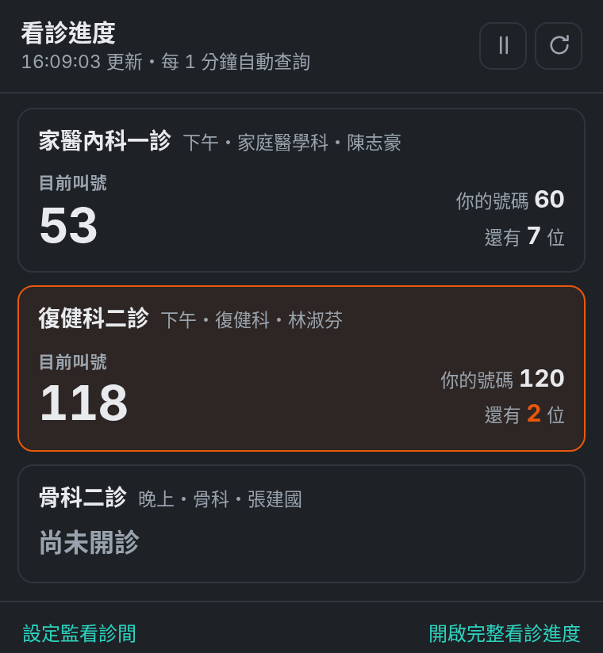
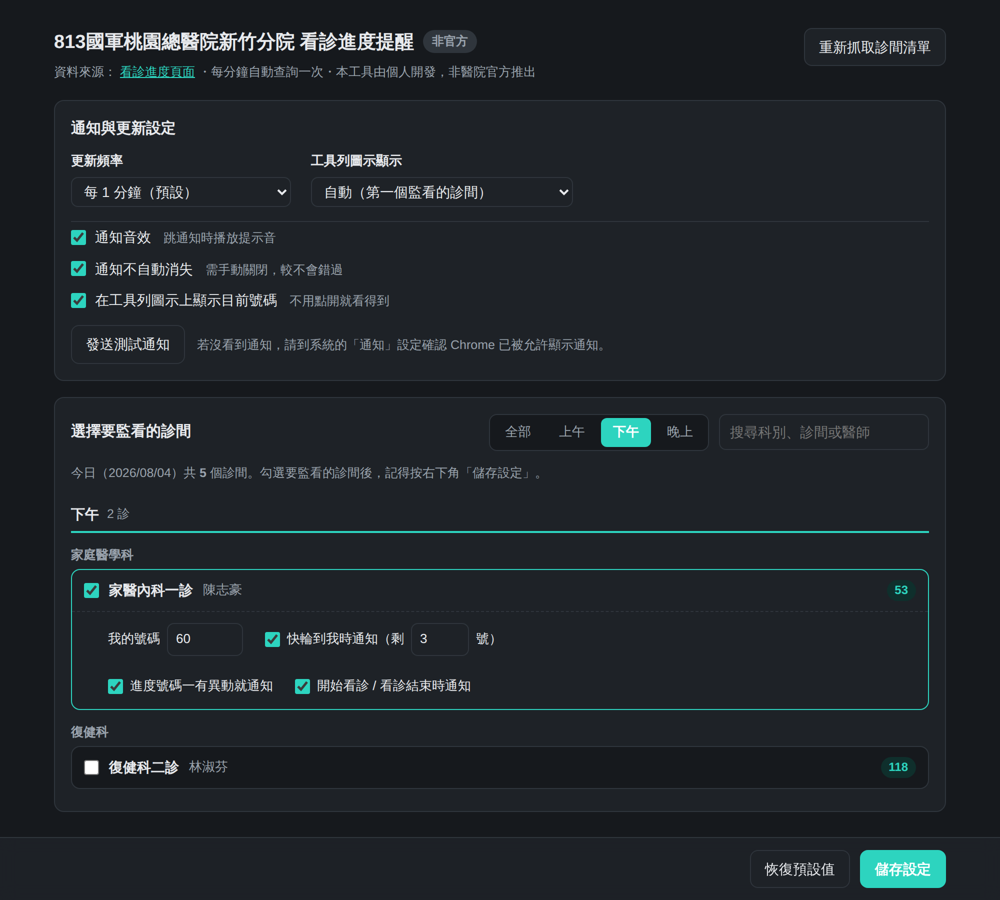

# 813國軍桃園總醫院新竹分院 看診進度提醒

**非官方工具**，由個人開發，非國軍桃園總醫院新竹分院推出，未經該院授權或背書。

這個 repo 有兩個版本，用同一支資料來源、同一套提醒邏輯：

| | 位置 | 適用 |
|---|---|---|
| **Chrome 擴充功能** | repo 根目錄（本文件） | 電腦。裝好就能用，不需要伺服器 |
| **手機版 PWA** | [`pwa/`](pwa/) | iPhone／Android。加到主畫面像 App，需自行部署一個 Cloudflare Worker |

手機版為什麼需要 Worker：醫院網站只有 http，而 PWA 強制 https，中間一定要有代理；
且手機瀏覽器不能在背景輪詢，要在螢幕鎖住時收到提醒只能靠伺服器推播。
詳見 [`pwa/README.md`](pwa/README.md)。

---

## Chrome 擴充功能

自動查詢 [813 醫院的看診進度頁面](http://www.813.com.tw/WebService/link/show_call2.html)，
指定的診間一有異動、或快輪到你的號碼時，直接跳 Chrome 通知——不用一直開著網頁按重新整理。

<p align="center">
  
</p>

- 可同時監看**多個診間**，每個診間的號碼與提醒條件各自獨立
- 填入自己的號碼後，可設定「剩 N 號才提醒」，不會每次查詢都被吵
- 工具列圖示直接顯示目前叫號，快輪到時會變色
- 設定頁**自動抓取當天的診間清單**，不用手動輸入科別或診間名稱
- 監看的診間**看診結束後會自動停止查詢**，不會整天空轉
- 支援淺色／深色模式

---

## 安裝

這個擴充功能沒有上架 Chrome 線上應用程式商店，請用「載入未封裝項目」的方式安裝。

1. 取得檔案：點右上角 **Code → Download ZIP** 後解壓縮，或 `git clone` 這個 repo
2. 打開 Chrome，網址列輸入 `chrome://extensions/`
3. 右上角把「**開發人員模式**」打開
4. 點左上角「**載入未封裝項目**」
5. 選擇**含有 `manifest.json` 的那個資料夾**
6. 安裝完會自動跳出設定頁

建議把工具列上的擴充功能圖示「釘選」起來，才看得到號碼徽章。

之後更新檔案（`git pull` 或重新下載）後，回到 `chrome://extensions/` 按那張卡片上的**重新整理圖示（↻）**
即可套用，你的設定不會被清掉。

---

## 使用方式

### 1. 設定要監看的診間



設定頁會**自動抓取今天的診間清單**，依「上午／下午／晚上」分好，
可用上方的時段分頁或搜尋框快速找到目標，例如切到「下午」再搜尋科別名稱。

勾選要監看的診間後，該列會展開細項：

| 欄位 | 說明 |
|---|---|
| 我的號碼 | 選填。填了才能做「快輪到我」提醒 |
| 快輪到我時通知（剩 N 號） | 剩幾號時開始提醒，預設剩 3 號 |
| 進度號碼一有異動就通知 | 每次叫號數字變動都通知 |
| 開始看診 / 看診結束時通知 | 診間開診、結束時各通知一次 |

**可以同時勾選多個診間**，改完記得按右下角「**儲存設定**」。

### 2. 通知行為

- **快輪到你了**：剩 N 號時提醒，同一個號碼只會提醒一次，不會每次查詢都重複吵你
- **輪到你了 / 已經過號**：各提醒一次
- **進度異動**：例如「看診進度 46 → 47」
- **開始看診 / 看診結束**：狀態改變時各一次
- 同一個診間使用固定的通知代號，新通知會**取代**舊的，不會堆一整排
- 點通知會直接打開醫院的看診進度網頁

當「快輪到你了」觸發時，就不會再重複發一則進度異動通知，避免同一件事跳兩次。

### 3. 全域設定

- **更新頻率**：預設每 **1 分鐘**，也可改成 30 秒（Chrome 對擴充功能的下限）／2／5 分鐘
- **通知音效**：跳通知時播放提示音；快輪到你時是三聲較急促的高音，一般異動是兩聲柔和音
- **通知不自動消失**：需手動關閉，比較不會錯過
- **工具列圖示顯示目前號碼**：不用點開就看得到，可指定要顯示哪一個診間

左下角的「**恢復預設值**」會把以上這幾項帶回原廠設定，
**已勾選的監看診間與號碼都不受影響**。按下後還要按「儲存設定」才會真的套用。

### 4. 即時面板

點工具列圖示會顯示所有監看中的診間：目前叫號、你的號碼還差幾位、最後更新時間。
快輪到時整列會變橘色，輪到你時變紅色。

右上角兩顆按鈕：**⏸ 暫停／▶ 繼續**自動查詢、**↻ 立即重新查詢**（查詢中圖示會轉動）。

### 5. 每天凌晨自動清除

每天**台北時間 00:00**，前一天的紀錄會自動清掉：

| 會清除 | 會保留 |
|---|---|
| 監看的診間清單 | 更新頻率、音效、通知樣式、徽章等所有設定 |
| 你填的號碼 | |
| 比對狀態與已通知紀錄 | |
| 當日進度快取 | |

號碼每天都不一樣、診間也只在當天的班表上，留著只會誤判，所以整批清掉最乾淨。

清除在三個地方各做一次，任何一邊沒跑到都不會出錯：

- **專屬排程**：每天台北 00:00 觸發，觸發後立刻排下一次
- **每分鐘輪詢**：發現紀錄上的日期不是今天就地清除（電腦整晚休眠時靠這個補）
- **啟動時**：Chrome 開啟或重新載入擴充功能時檢查一次

判斷「這份資料是哪一天的」時，**以資料自己帶的日期為準**（比對基準的 `__date`、進度快取的日期），
最後才看儲存的 `day` 欄位。順序不能反過來——只要有任何一版曾經在沒清資料的情況下把 `day` 寫成今天，
先看 `day` 就會讓那些過期資料永遠被當成今天的。

日期檢查在 `poll()` 裡、**去重判斷之外**先做完。放在查詢流程裡面的話，只要有一次查詢卡在網路上沒回來，
之後每次呼叫都只會拿到那個卡住的 promise，跨日清除就再也不會執行。查詢本身另外有 30 秒看門狗。

不想要的話，設定頁可以關掉「每天凌晨 00:00 自動清除前一天的紀錄」；
關掉後仍會在跨日時重置比對基準，只是監看的診間與號碼會留著。

要立刻清掉的話，設定頁有「**清除目前的監看清單**」按鈕。

### 6. 看診結束後自動停止

當你監看的診間**全部**都變成「看診結束」（或今天根本沒排這個診）時，
擴充功能會自動停止密集查詢，標題旁會出現「今日已結束」，改成每 30 分鐘確認一次就好。

隔天班表出來、或診間重新開診時會自動恢復原本的頻率，不需要手動處理。
只要還有任何一個監看中的診間還在看診、或尚未開診，就會維持正常查詢。
瀏覽器重新啟動時也一律先回到正常頻率確認過當天班表，避免早上慢半拍。

隨時可以按 ↻ 手動查詢，不受這個機制影響。

### 7. 號碼過了就停止監看

當最新的數字進度**大於你填的號碼**時，只停用該診間的監看；若第一次查詢就已經過號，會安靜停用。通常在進度跨過號碼時仍會收到一次「已經過號」提醒。沒有啟用中的監看時會停止自動查詢，手動重新查詢與每日清除仍可使用。

想繼續監看時，到設定頁更改號碼並儲存，或重新勾選該診間。診間和原有提醒設定會保留。

---

## 疑難排解

**完全沒跳通知**
先到設定頁按「發送測試通知」。如果連測試通知都沒出現，是系統擋掉了：
到「系統設定 → 通知 → Google Chrome」確認通知已開啟。
測試通知會出現、但實際進度變了卻沒通知，多半是該診間今天沒開診（面板會顯示「今日無此診」或「尚未開診」）。

**通知幾秒就自己消失（macOS）**
macOS 預設的通知樣式是「橫幅」，不管擴充功能怎麼設定都會自動滑掉。
到「系統設定 → 通知 → Google Chrome」把樣式改成「**提醒**（Alerts）」就會留在畫面上。

**工具列圖示沒有數字**
確認圖示有被「釘選」出來，且設定頁的「在工具列圖示上顯示目前號碼」有勾。
顯示 `–` 代表該診間今天不在班表上，顯示 `!` 代表抓取失敗。

**面板顯示「查詢失敗」**
醫院網站或院內網路暫時不通。擴充功能會保留上一次的資料並繼續重試，通常等下一輪就會恢復；
也可以按 ↻ 手動重試。

**面板顯示「今日已結束」但我還想繼續看**
代表你監看的診間今天都已看診結束，進度不會再變動了。
按 ↻ 可以手動查詢；隔天會自動恢復。若想改看別的診間，到設定頁重新勾選即可。

**設定頁列不出我要的診間**
醫院的 API 只回傳**當天**的班表，所以只列得出今天有開的診。
隔天要看的診，要等當天才會出現在清單裡。

**改了設定卻沒生效**
確認有按右下角「儲存設定」。左下角的「恢復預設值」按下後也需要再按儲存。

---

## 幾件值得知道的事

**Chrome 要在執行中。** 這是靠 Chrome 的背景服務在查詢，Chrome 完全關掉就不會查了
（視窗最小化、只留分頁沒關係）。筆電闔上睡眠時也會暫停，醒來後會自動恢復。

**剛勾選的診間不會馬上跳通知。** 第一次抓到該診間的進度只會當成比對基準，
要等到下一次進度真的變動才會通知，避免一設定完就被洗版。換日時也會自動重新抓基準。

**醫院網站只有 http 沒有 https**，所以 `manifest.json` 的權限是 `http://www.813.com.tw/*`。
擴充功能的背景程序可以正常對 http 發出請求，不受一般網頁的混合內容限制。

**所有資料都留在你自己的瀏覽器裡。** 設定存在 `chrome.storage.local`，
除了查詢醫院自己的 API 之外不會對外連線，也沒有任何追蹤或統計。
完整說明見 [隱私權政策](PRIVACY.md)。

**本工具由個人開發，非國軍桃園總醫院新竹分院官方推出**，未經該院授權或背書。
看診進度以醫院現場公告為準，本工具僅供參考。

---

## 技術細節

看診進度網頁本身是呼叫這支 JSON API 產生表格的，本擴充功能直接使用同一個來源，
比解析 HTML 穩定：

```
http://www.813.com.tw/WebService/WebService.asmx/HISAPI?_Str=<base64>
```

`_Str` 解開後是 `{"Functionname":"GET_REG_VISIT_PROGRESS_GET","Jsonmode":"true","SYSTEM":"REGWSAPI"}`。

回傳欄位：

| 欄位 | 意義 |
|---|---|
| `SCD_VISITDT` | 看診日期（`20260804`） |
| `SHI_EASYNAME` | 時段（上午／下午／晚上） |
| `SEC_SENAME` | 科別 |
| `EMP_EMPNAME` | 醫師 |
| `ROM_RONAME` | 診間 |
| `CLC_MAXIMUM` | 看診進度（數字 ／ `看診結束` ／ `-`） |
| `CLC_VISITNO_NOW` | 目前號碼 |

### 檔案結構

```
manifest.json     Manifest V3 設定
common.js         API 位址、共用型別判斷與工具函式
background.js     背景服務：定時輪詢、比對差異、發通知、更新徽章
options.html/js   設定頁
popup.html/js     工具列即時面板
offscreen.js      提示音（service worker 沒有 Audio API，需透過 offscreen document）
shared.css        共用樣式（淺色／深色）
docs/             說明文件用的截圖（示範資料，非真實看診紀錄）
test/             測試（見 test/README.md）
PRIVACY.md        隱私權政策
```

### 實作重點

- 輪詢用 `chrome.alarms`，不是 `setInterval`——MV3 的 service worker 會被休眠，計時器不可靠
- 網路請求有 20 秒逾時保護（`AbortController`），避免連線卡住讓輪詢整個停擺
- 抓取失敗時保留上一次的資料，不會把畫面清空，也不會誤發通知
- 提示音透過 offscreen document 的 Web Audio 產生，不需要額外的音檔
- 每個監看項目各自記錄上次的進度與已提醒過的號碼，避免重複通知
- 輪詢模式（`active` / `idle`）每次抓取後都會比對實際的 alarm 週期並自我修正，狀態不會長期漂移
- 凌晨清除用一次性 alarm 並在觸發後立刻重排，比固定 24 小時週期更不容易因休眠而漂移；
  清除函式本身負責重排，所以由輪詢的防呆路徑觸發時也不會漏掉下一次
- 日期檢查不受「同時只跑一次查詢」的去重影響，且查詢有 30 秒看門狗，
  避免單一次卡住的網路請求把之後所有查詢與清除一起凍住
- `schemaVersion` 做一次性資料修復，讓從任何舊版升級上來的使用者都能回到乾淨狀態

---

## 測試

```bash
node test/logic.test.mjs        # 不需要瀏覽器
node test/daily-reset.e2e.mjs   # 需要 Playwright + Chromium
```

細節見 [`test/README.md`](test/README.md)。

---

## 版本紀錄

| 版本 | 內容 |
|---|---|
| 1.0.8 | 字型堆疊補上 Inter 與 Noto Sans CJK TC，非 macOS 環境不再 fallback 到 DejaVu Sans；說明文件與上架素材的截圖重新產生 |
| 1.0.7 | 真正修好過期紀錄清不掉的問題：日期檢查移出查詢的去重範圍（原本一次卡住的查詢會讓清除永遠不執行）、改以資料自己的日期為準、加上一次性資料修復與 30 秒查詢看門狗 |
| 1.0.6 | 嘗試修正升級後清不掉舊紀錄的問題（僅部分有效） |
| 1.0.5 | 新增每天凌晨 00:00 自動清除前一天的診間與號碼（可關閉），並新增「清除目前的監看清單」按鈕 |
| 1.0.4 | 為上架 Chrome 線上應用程式商店調整：描述與設定頁加上「非官方」標示、商店圖示補上規定的透明邊距、新增隱私權政策 |
| 1.0.3 | 監看的診間全部看診結束後自動停止密集查詢，改為每 30 分鐘確認，隔天自動恢復 |
| 1.0.2 | 更新頻率預設改為 1 分鐘；「重設比對基準」改為「恢復預設值」（不影響已監看的診間） |
| 1.0.1 | 即時面板重新排版：按鈕改為圖示、加寬版面、加上「目前叫號」標示 |
| 1.0.0 | 首次發布 |
